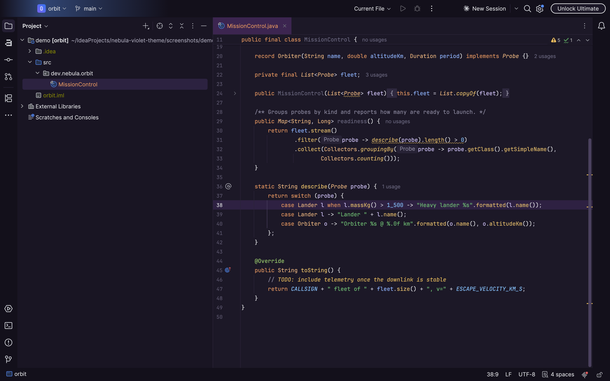
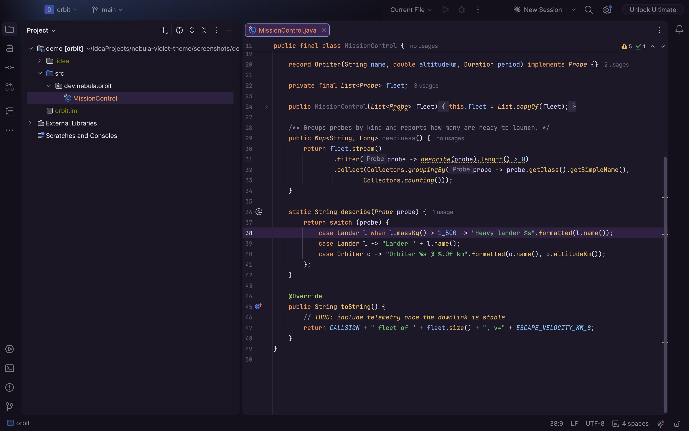

# Nebula Violet Theme

A deep dark-purple theme for IntelliJ-based IDEs (2024.1+), with two variants:

| Theme | Use it with |
|---|---|
| **Nebula Violet** | Classic UI, or the New UI without islands |
| **Nebula Violet Islands** | The Islands UI (2025.3+): rounded tool windows and editor on a darker frame |

Both use the bundled **Nebula Violet** editor color scheme.

| Nebula Violet | Nebula Violet Islands |
|---|---|
|  |  |

## Layout

- `src/main/resources/themes/NebulaViolet.theme.json` holds the palette and UI keys (single source of truth)
- `src/main/resources/themes/NebulaViolet.xml` is the editor color scheme
- `src/islands/NebulaVioletIslands.overlay.json` holds only the Islands-specific keys. The build
  (`generateIslandsTheme`) merges it over the classic theme to produce `NebulaVioletIslands.theme.json`.

## Build and try

```bash
./gradlew buildPlugin      # -> build/distributions/nebula-violet-theme-<version>.zip
./gradlew runIde           # sandbox IDE with the theme loaded
./gradlew verifyPlugin     # JetBrains Plugin Verifier against current + latest IDEA
./gradlew screenshots      # re-render screenshots/out/*.png for the Marketplace listing
```

`screenshots` runs a sandbox copy of your local IntelliJ (default `~/Applications/IntelliJ IDEA.app`,
override with `-PscreenshotIde=...`; needs 2025.3+ for Islands) on `screenshots/demo`. A small
helper plugin (`screenshots/helper`, sandbox-only, never published) paints the window to PNG for each
theme and quits the IDE. This doesn't need macOS screen-recording permission.

Install manually via *Settings | Plugins | ⚙ | Install Plugin from Disk…* and pick the zip.

## Publishing to JetBrains Marketplace

1. Bump `version` in `gradle.properties` and add a `<change-notes>` entry in `plugin.xml`.
2. Sign. The key and certificate live outside the repo in `~/.jetbrains-signing/` (key encrypted,
   password in the macOS Keychain as `jetbrains-plugin-signing`). The signer can't decrypt
   OpenSSL-encrypted keys itself, so the key is decrypted in memory only:

   ```bash
   PW="$(security find-generic-password -a "$USER" -s jetbrains-plugin-signing -w)"
   export CERTIFICATE_CHAIN="$(cat ~/.jetbrains-signing/chain.crt)"
   export PRIVATE_KEY="$(openssl rsa -in ~/.jetbrains-signing/private.pem -passin pass:"$PW" 2>/dev/null)"
   ./gradlew signPlugin   # -> build/distributions/*-signed.zip
   ```

3. First release: upload `build/distributions/*-signed.zip` at <https://plugins.jetbrains.com/plugin/add>.
   Choose the *Themes* category and add screenshots of both variants.
4. Later releases: run the exports above plus `export PUBLISH_TOKEN=<token>` (Marketplace → My Tokens),
   then `./gradlew publishPlugin`.

## License

MIT, see [LICENSE](LICENSE).
