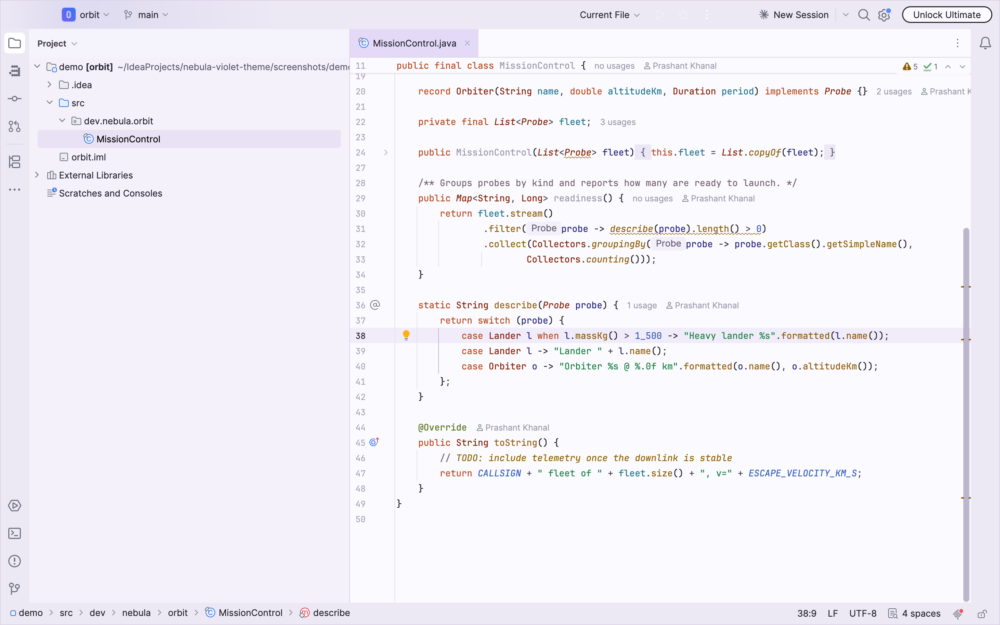
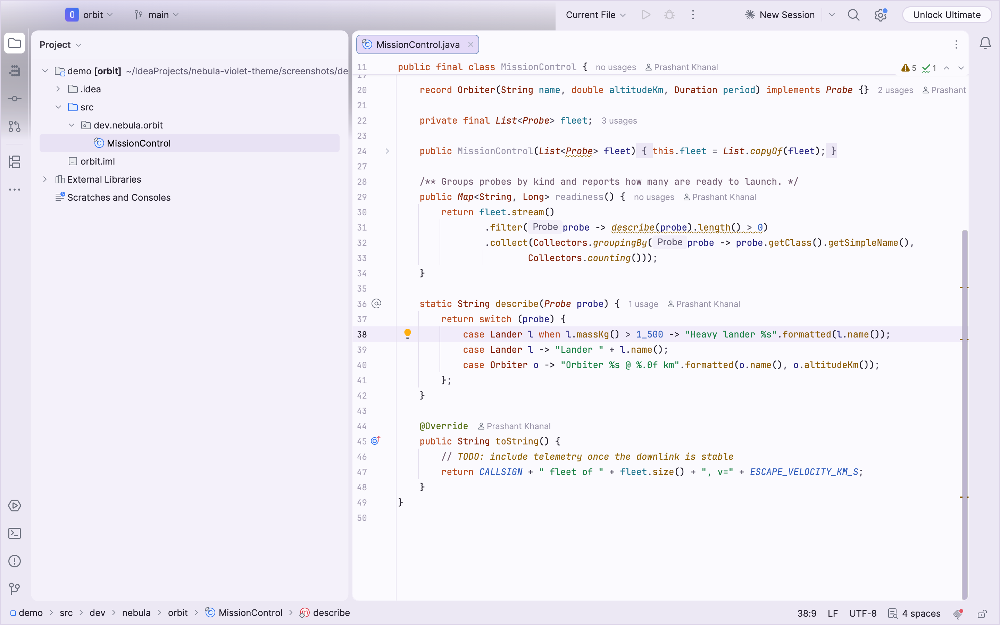
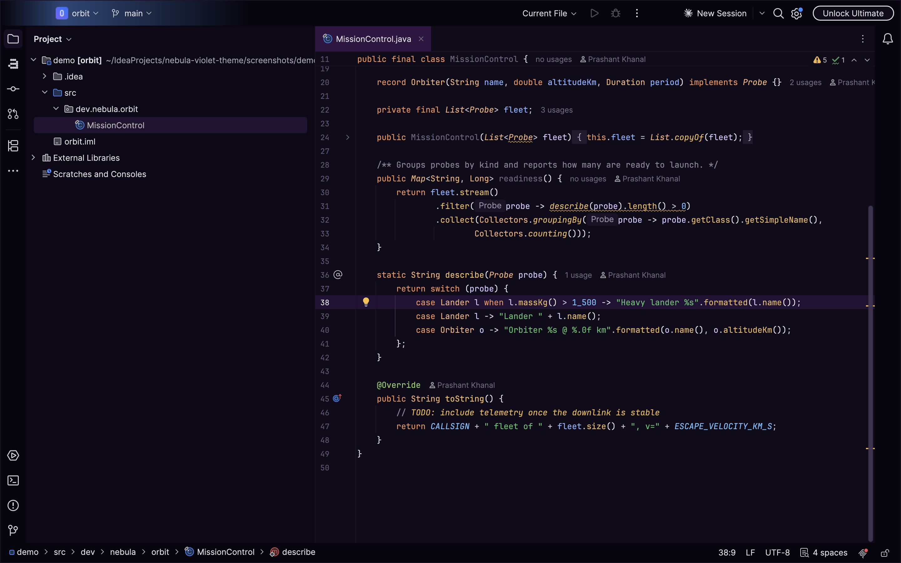
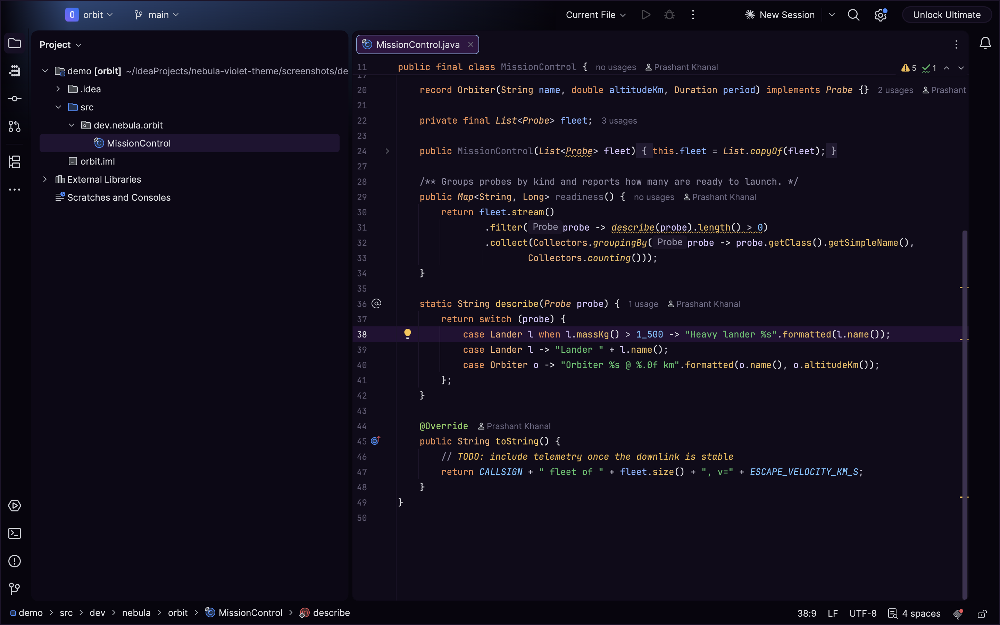
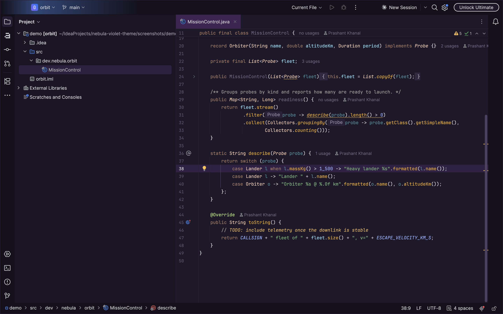
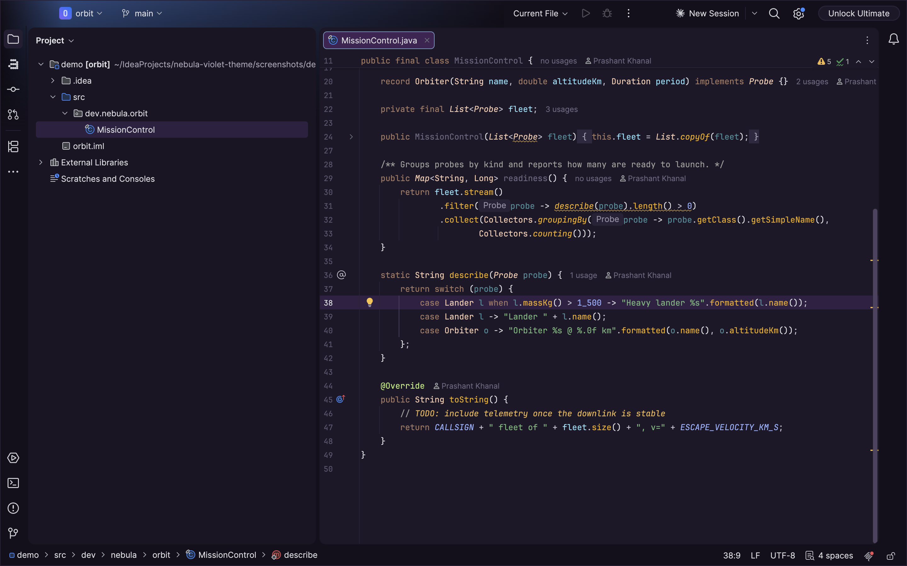
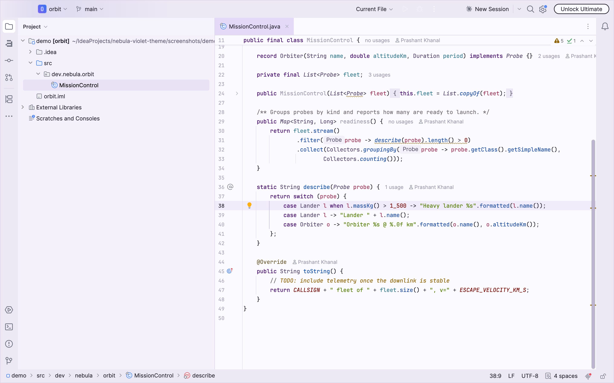
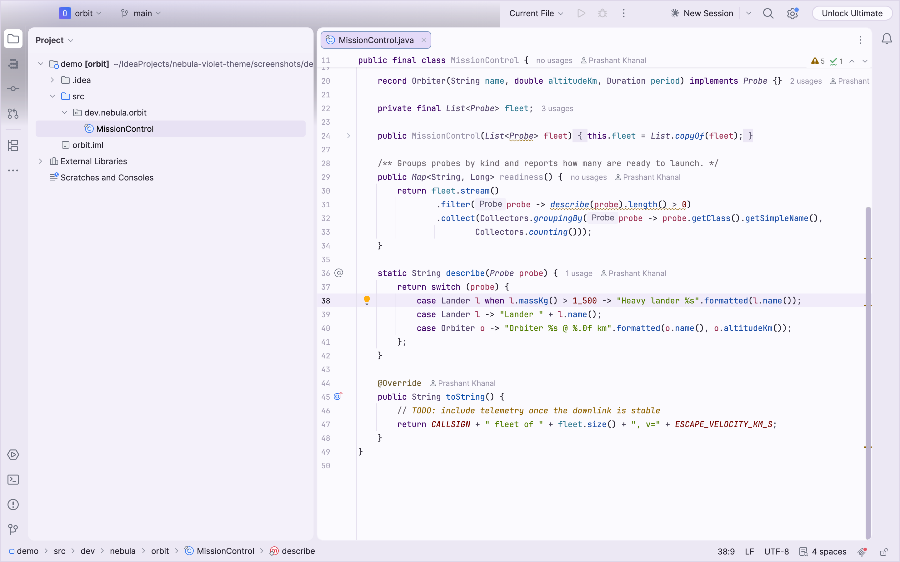
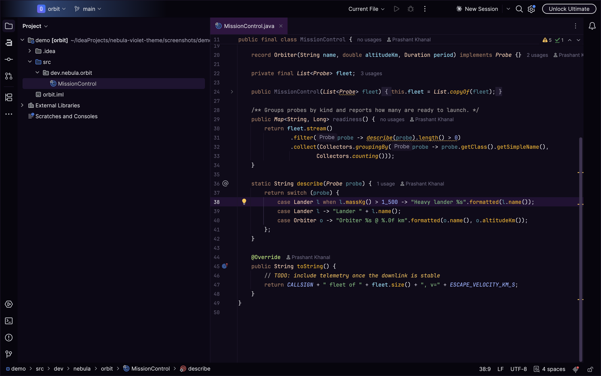
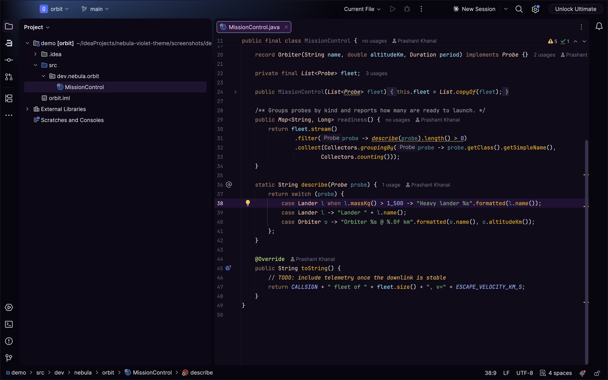

# Nebula Violet Theme

A violet theme family for IntelliJ-based IDEs (2024.1+). There are three brightness levels, each
in a standard and a colorblind-safe palette, and each palette comes in two layouts:

| Palette | Standard | Colorblind-safe |
|---|---|---|
| Light: lavender chrome, white editor | **Nebula Violet Light** | **Nebula Violet Light Colorblind** |
| Dark: deep purple (the original) | **Nebula Violet** | **Nebula Violet Colorblind** |
| Midnight: near-black, for low light and OLED screens | **Nebula Violet Midnight** | **Nebula Violet Midnight Colorblind** |

Every theme also has an **Islands** version for the Islands UI (2025.3+), with rounded tool windows
and editor on a separate frame; use the plain version for the Classic UI or the New UI without islands.
Each palette bundles its matching editor color scheme.

The colorblind-safe syntax and status colors were found by optimization. Within each group (syntax,
errors and warnings, diff gutter, file status, console) the optimizer maximizes the smallest CIEDE2000
difference between any two colors under simulated protanopia, deuteranopia and tritanopia. It keeps
WCAG AA contrast and stays close to the standard hues. The build enforces the result: every pair must
be at least 10 apart in each simulation (see [Palette audit](#palette-audit)).

| Nebula Violet | Nebula Violet Islands |
|---|---|
|  |  |

| Nebula Violet Light | Nebula Violet Light Islands |
|---|---|
|  |  |

| Nebula Violet Midnight | Nebula Violet Midnight Islands |
|---|---|
|  |  |

| Nebula Violet Colorblind | Nebula Violet Colorblind Islands |
|---|---|
|  |  |

| Nebula Violet Light Colorblind | Nebula Violet Light Colorblind Islands |
|---|---|
|  |  |

| Nebula Violet Midnight Colorblind | Nebula Violet Midnight Colorblind Islands |
|---|---|
|  |  |

## Layout

Colors live in exactly one place: a palette per variant. Everything else refers to colors by role.

- `src/theme/palettes/<variant>.json`: the variant's name and its color roles (`panel`, `keyword`,
  `caretRow`, `ansiRed`, ...), plus the audit's accepted known issues.
- `src/theme/template/theme.json`: UI keys, with role names as values (`"Tree.background": "panelAlt"`).
- `src/theme/template/islands.json`: only the Islands-specific keys, merged over `theme.json`.
- `src/theme/template/scheme.xml`: the editor color scheme, with `${role}` placeholders.
- `buildSrc/`: the `generateThemes` and `auditPalettes` tasks.

`generateThemes` renders each palette into `<Name>.theme.json`, `<Name>Islands.theme.json` and
`<Name>.xml`, with every role resolved to a literal color. It fails on an unknown role, on a role no
template uses, and on a generated theme that `plugin.xml` doesn't register.

To add a variant, copy a palette, rename it, change colors, and add its two `<themeProvider>`
entries to `plugin.xml`.

## Palette audit

`./gradlew auditPalettes` (also run by `check` and `buildPlugin`) measures every palette against
`src/theme/audit-rules.json` and writes `build/reports/palette-audit/<variant>.md`:

| Check | Method | Rule |
|---|---|---|
| Syntax and UI text on the editor background, plus listed text/background pairs | WCAG 2.x contrast ratio | ≥ 4.5 (AA) |
| De-emphasized text (line numbers, disabled) | APCA Lc, the WCAG 3 candidate | ≥ 15 (still visible) |
| Every pair of syntax colors | CIEDE2000 color difference | ≥ 10 |
| The same pairs under protanopia, deuteranopia, tritanopia | Machado et al. 2009 simulation, then CIEDE2000 | measured always; enforced when the palette sets `audit.cvdMinDeltaE` |

The contrast thresholds come from the standards. The ΔE ≥ 10 bar is this project's choice: about 1
is just noticeable for side-by-side swatches, and thin glyphs need far more to read as different
categories at a glance.

A failing check breaks the build unless the palette lists its id under `audit.knownIssues` with a
reason. Fixing a known issue also breaks the build until it's removed from the list, so the list
only shrinks.

## Build and try

```bash
./gradlew buildPlugin      # -> build/distributions/nebula-violet-theme-<version>.zip
./gradlew auditPalettes    # contrast / distinctness report per palette
./gradlew runIde           # sandbox IDE with the theme loaded
./gradlew verifyPlugin     # JetBrains Plugin Verifier against current + latest IDEA
./gradlew screenshots      # re-render screenshots/out/*.png for the Marketplace listing
```

`screenshots` runs a sandbox copy of your local IntelliJ (default `~/Applications/IntelliJ IDEA.app`,
override with `-PscreenshotIde=...`; needs 2025.3+ for Islands) on `screenshots/demo`. A small
helper plugin (`screenshots/helper`, sandbox-only, never published) paints the window to PNG for each
theme and quits the IDE. This doesn't need macOS screen-recording permission.

Install manually via *Settings | Plugins | ⚙ | Install Plugin from Disk…* and pick the zip.

## Publishing to JetBrains Marketplace

1. Bump `version` in `gradle.properties` and add a `<change-notes>` entry in `plugin.xml`.
2. Sign. The key and certificate live outside the repo in `~/.jetbrains-signing/` (key encrypted,
   password in the macOS Keychain as `jetbrains-plugin-signing`). The signer can't decrypt
   OpenSSL-encrypted keys itself, so the key is decrypted in memory only:

   ```bash
   PW="$(security find-generic-password -a "$USER" -s jetbrains-plugin-signing -w)"
   export CERTIFICATE_CHAIN="$(cat ~/.jetbrains-signing/chain.crt)"
   export PRIVATE_KEY="$(openssl rsa -in ~/.jetbrains-signing/private.pem -passin pass:"$PW" 2>/dev/null)"
   ./gradlew signPlugin   # -> build/distributions/*-signed.zip
   ```

3. First release: upload `build/distributions/*-signed.zip` at <https://plugins.jetbrains.com/plugin/add>.
   Choose the *Themes* category and add screenshots of both variants.
4. Later releases: run the exports above plus `export PUBLISH_TOKEN=<token>` (Marketplace → My Tokens),
   then `./gradlew publishPlugin`.

## License

MIT, see [LICENSE](LICENSE).
